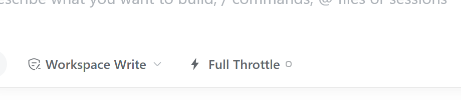
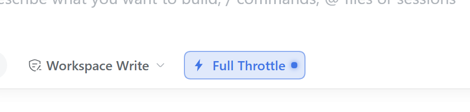

# dsh-full-throttle（火力全开）

[English](README.md) | 中文

DeepSeek Harness 的“火力全开”模式：在输入框工具栏加一个开关，开启后向该 profile 下每个会话与
子代理的系统提示词注入一段高强度指令。

> 我们是一家实力雄厚的大模型公司，你的 token 用量预算无限，不要吝惜或有所保留。一切以高标准完成任务为优先。

关闭时注入的 section 会完全移除。

### 可选：鼓励使用子代理（默认关闭）

在上面那段之外，还可以额外注入一句独立的话。它**默认关闭**、有自己独立的开关——因为
「要一段高预算的措辞」和「希望把活拆给子代理」是两件不同的事：

> 当任务足够复杂、可以并行推进时，鼓励先组建智能体团队分工协作；如果任务本身不需要拆分，不必勉强。

打开方式：**设置 → 火力全开 → 鼓励使用子代理**（与下面的 `subagents` 配置项等价）。
这句话只在主开关打开时才会注入，其余情况下两个设置互不影响。

## 外观

| 关闭 | 开启 |
| --- | --- |
|  |  |

文案跟随界面语言：英文 **Full Throttle**，中文 **火力全开**。右侧小圆点表示状态
（空心 = 关闭，实心 + 强调色 = 开启），因此在会重刷输入框按钮样式的主题里也能看出状态。

## 安装

1. 打开 DeepSeek Harness，进入侧栏的 **插件** 页。
2. 点击 **添加插件**，粘贴本仓库地址：

   ```text
   https://github.com/RorschachXR/dsh-full-throttle
   ```

3. 点击 **安装**；完成后选择 **立即启用**（也可以稍后在插件页启用该组合包）。

地址后也可以加分支或标签：`#main` 或 `#v0.1.0`。插件暂不支持自动更新——升级请先卸载再安装新版。

## 卸载

进入 **插件 → 已安装**，打开 **火力全开**，点击 **卸载**。

开关状态单独保存在 `$DSH_HOME/full-throttle.json`；想重置为关闭可自行删除该文件。

## 使用

- 点击输入框工具栏中的开关（模型选择器左侧、权限 chip 旁边）。
- 状态是 profile 级全局：对所有会话与子代理生效，并在它们下一次模型请求时生效；重启后保持。
- 默认注入文本即上面那段中文。如需替换，在 profile 的 `cordis.patch.yml` 中覆盖该行配置
  （进阶用法，可选）：

  ```yaml
  - id: full-throttle
    config:
      instructions: '预算不设上限，不达高标准不罢休。'
  ```

- 可选的子代理那一句也有独立配置，同样可以替换：

  ```yaml
  - id: full-throttle
    config:
      subagents: true
      subagentInstructions: '适合并行时，把独立的工作拆给子代理。'
  ```

  在设置页里操作子代理开关之前，`subagents` 提供默认值；只切换主开关仍会跟随配置默认值。
  在设置页里拨过子代理开关之后，你的选择会写进
  `$DSH_HOME/full-throttle.json` 并以那里为准。`subagentInstructions` 留空时回落到上面的默认句。

## 兼容性

- 颜色、圆角、字体只使用宿主主题 token，支持库存亮/暗主题与第三方主题。
- **PRTS**：该主题会用 `!important` 重刷输入框卡片内所有按钮；本插件用 id 作用域 + `!important`
  覆盖开启态，并改写 PRTS 自己的控制变量，使开启态呈现 PRTS 黄；状态圆点作为兜底。
- 内置中英文字典，插件管理器中显示的标题与描述也已本地化。

